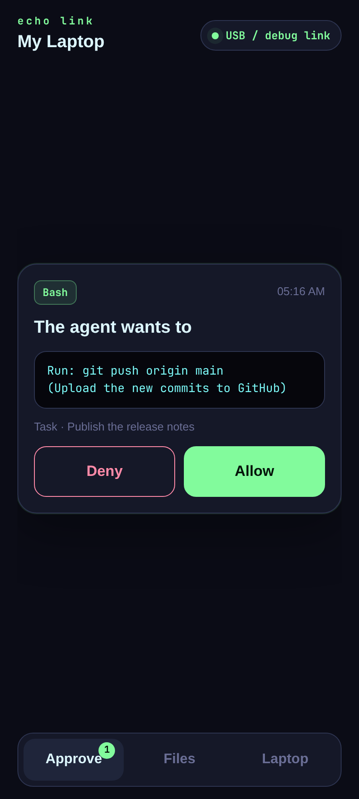
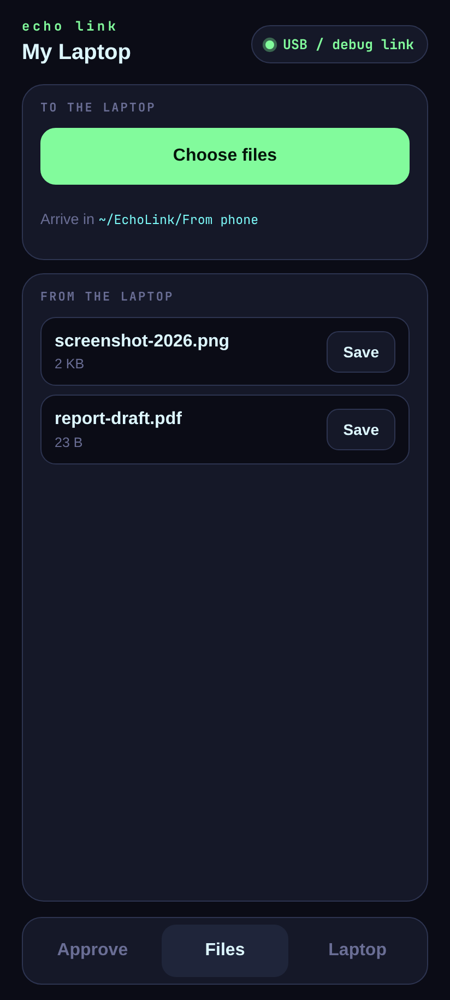
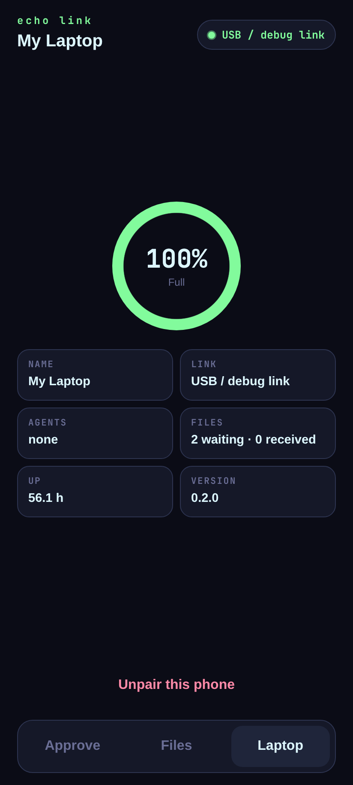

# Echo Link


Approve your laptop's AI agent from your phone, and move files between them.

Echo Link pairs an Android phone with a Linux laptop (made for [Omarchy](https://omarchy.org), works on any Arch-based system). The agent works on the laptop, and **every action that changes something waits for your tap**. You see the exact command, then Allow or Deny.

| | |
|---|---|
| **Approve** | Each command, file write or web request the agent wants to make, shown in full |
| **Files** | Phone → laptop into `~/EchoLink/From phone` · laptop → phone from `~/EchoLink/To phone` |
| **Laptop** | Battery, link, agents and files at a glance |

<p>
  
  
  
</p>

## How it connects

The phone reaches the laptop the best way available, and the laptop opens the link by itself:

1. **USB cable or Wireless debugging.** `echolinkd` sees the phone through `adb` and opens a private tunnel. No firewall change needed.
2. **Wi-Fi.** The phone talks to the laptop directly on port 47025. To allow your home network: `sudo ufw allow from 192.168.0.0/16 to any port 47025 proto tcp`

Pairing happens once, by **QR code** or **6-digit PIN**. Messages are encrypted (AES-256-GCM) with a key only the two devices hold. With a PIN, the PIN itself never travels: the devices prove they know it, then agree a new key (ECDH P-256 + HKDF). Five wrong tries, or three minutes, closes the PIN.

## Laptop

```sh
# Arch / Omarchy, from this repository
git clone https://github.com/toyCaller/echo-link && cd echo-link/packaging/arch
makepkg -si
systemctl --user enable --now echolinkd

echolink pair               # QR code in the terminal (add --show for a window)
echolink pair --pin         # or a 6-digit PIN
echolink run "tidy up the downloads folder" ~/Downloads   # the agent; your phone approves
echolink send report.pdf    # offer a file to the phone
echolink status
```

`echolink run` uses [Claude Code](https://claude.com/claude-code) with your own account. Read-only actions run freely; everything else waits for the phone. `echolink stop` ends every agent and denies anything waiting.

Optional settings go in `~/.config/echo-link/config.json`:

```json
{ "name": "My Laptop", "contextFile": "/path/to/notes-for-the-agent.md", "folder": "/path/to/EchoLink" }
```

## Phone

Android 8 or newer. Download the APK from [Releases](https://github.com/toyCaller/echo-link/releases) (F-Droid submission planned).

## Build

```sh
cd app && npm install && npm run android
cd android && ./gradlew assembleRelease
```

The laptop service is plain Node.js (22+) with no dependencies.

## License

MIT. See [LICENSE](LICENSE).

## Not affiliated

Echo Link works with Claude Code but is not made by or affiliated with Anthropic.
